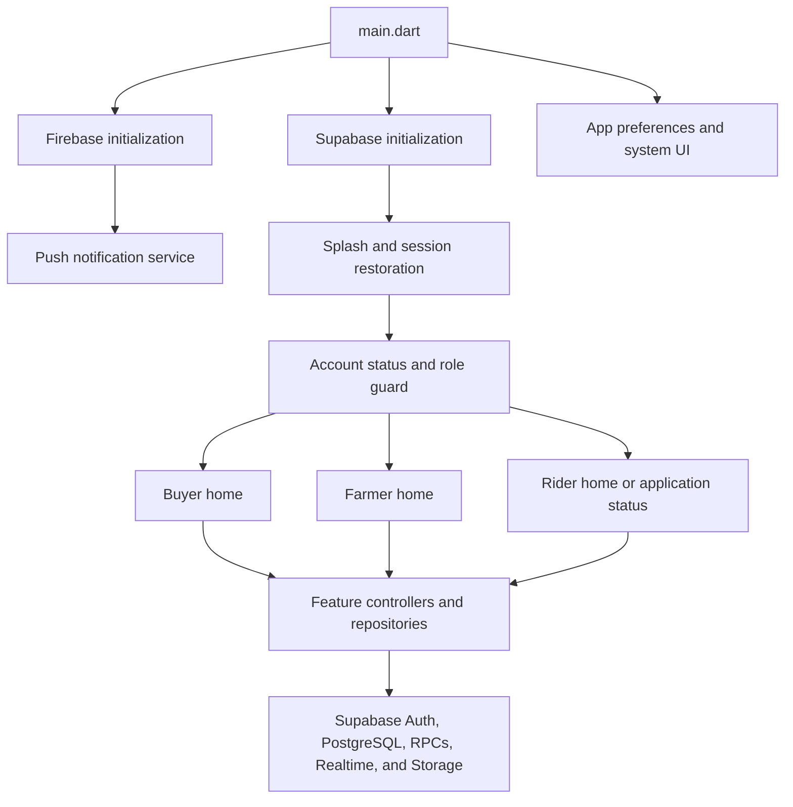

# Architecture overview

AgriSell uses feature-first Flutter modules with explicit data, domain, and
presentation boundaries. Role-specific code owns its workflows, while
cross-role models and UI live under `features/shared`.

## Runtime overview



`main.dart` is intentionally small: it prepares platform services, creates the
`MaterialApp`, defines guarded named routes, and delegates account routing to
the authentication feature.

## Layers

Most feature modules follow these folders:

```text
<feature>/
  data/           Supabase/local data sources, repositories, DTO mapping
  domain/         Typed entities, value objects, validation, business rules
  presentation/   Screens, controllers, view state, and widgets
```

The intended dependency direction is:

```text
presentation -> domain
presentation -> data abstractions or injected repositories
data         -> domain
role feature -> shared feature
```

Code under `features/shared` must not depend on buyer, farmer, or rider
presentation screens. Reusable widgets receive typed data and callbacks instead
of navigating to role-owned destinations themselves.

## Module ownership

### Core

`lib/core` contains application-wide infrastructure:

- `constants/` — route names, fixed values, and asset identifiers
- `services/` — Supabase bootstrap, secure session storage, push
  notifications, font preferences, and system UI behavior
- `theme/` — the AgriSell palette, typography, and shared component styles
- `utils/` — reusable formatting, routing, and helper functions
- `widgets/` — application-wide UI primitives and inherited scopes

### Authentication

`lib/features/auth` owns registration, login, OTP presentation, saved-account
selection, session restoration, account-status checks, and dashboard routing.

The recognized roles are `buyer`, `farmer`, and `rider`. Account statuses
include active, pending, suspended, rejected, disabled, and unknown. Role gates
protect named routes and redirect users to the correct dashboard. A rider with
a pending or rejected application is routed to an application-status screen
instead of the rider dashboard.

### Buyer

`lib/features/buyer` owns:

- farm and product discovery
- basket state and checkout inventory validation
- cash-on-delivery and GCash selection
- order tracking and feedback
- buyer-to-farmer conversation launching
- profile and shipping-address management

### Farmer

`lib/features/farmer` owns:

- farmer and farm registration
- product creation, editing, availability, and restocking
- reservation and fulfillment workflows
- GCash review and order cancellation
- rider discovery, selection, and assignment requests
- buyer messaging, profile, history, and feedback

### Rider

`lib/features/rider` owns:

- rider application and profile management
- availability, connectivity, dashboard metrics, and history
- delivery request matching and acceptance
- multi-delivery batching and route presentation
- pickup confirmation, evidence capture, COD collection, and completion
- delivery conversations, notifications, ratings, and safety reporting

### Shared features

`lib/features/shared` contains capabilities used by more than one role:

- `chat/` — marketplace conversation entities, repositories, and controllers
- `location/` — GPS gateways, Philippine address data, map selection, and
  reusable location widgets
- `notifications/` — shared notification behavior
- `orders/` — order entities, repositories, persistence, and controllers
- `payments/` — payment details and price formatting
- `products/` — catalog entities, repositories, reviews, and product widgets
- `profile/` — shared profile data
- `widgets/` — cross-role feature-level UI

## Data and state

Production repositories use the initialized Supabase client and map database or
RPC responses into typed domain objects. Controllers coordinate loading,
mutation, empty, and error states for presentation widgets. Interfaces and
constructor injection allow tests to supply in-memory repositories, gateways,
or fixtures without a live backend.

Some features support clearly labelled temporary local behavior when Supabase
is unavailable. Local fallback data must remain isolated from production paths
and must never silently impersonate a successful backend response.

## Navigation and authorization

The root app registers guarded buyer and farmer routes in `main.dart` and uses
generated routes for argument-dependent destinations such as a farmer shop.
Dashboard navigation is owned by each role's home screen.

Client-side role gates improve navigation safety and user experience, but they
are not a database security boundary. Supabase Row Level Security, grants, and
authorized RPCs must enforce the same ownership and role rules server-side.

## Cross-cutting integrations

- **Supabase Auth:** production identity, session refresh, and email OTP
- **PostgreSQL/RPCs:** marketplace, order, rider, payment, and messaging data
- **Supabase Realtime:** live workflow updates where repositories subscribe
- **Supabase Storage:** profile, product, receipt, and delivery evidence assets
- **Firebase Cloud Messaging:** device token registration and notification
  delivery
- **OpenStreetMap:** map tiles used by reusable Flutter Map widgets
- **Secure storage:** persisted Supabase sessions and remembered account state

## Adding a feature

1. Choose the owning role or a genuinely shared capability.
2. Put business rules and typed entities in `domain/`.
3. Put Supabase/local persistence and response mapping in `data/`.
4. Put controllers, screens, and widgets in `presentation/`.
5. Inject repository interfaces or gateways where behavior needs isolation.
6. Add unit tests for rules, repository tests for mapping/mutations, and widget
   tests for visible states and user interactions.
7. Add a migration and RLS policies for every new server-side data path.

Follow the detailed placement and dependency rules in the repository's
`agent.md` before adding or moving source files.
