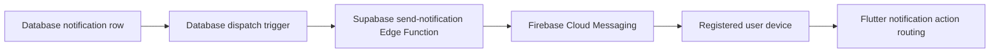

# Backend and configuration

AgriSell uses Supabase for production authentication and application data, and
Firebase Cloud Messaging for push delivery. This guide separates client-safe
configuration from hosted secrets and explains the repository's backend
layout.

## Client configuration

The Supabase bootstrap is implemented in
`lib/core/services/agrisell_supabase.dart`. For local development, create the
ignored file `assets/config/supabase.local.json`:

```json
{
  "SUPABASE_URL": "https://your-project.supabase.co",
  "SUPABASE_PUBLISHABLE_KEY": "your-publishable-key"
}
```

Compile-time overrides are supported:

```sh
flutter run --dart-define=SUPABASE_URL=https://your-project.supabase.co --dart-define=SUPABASE_PUBLISHABLE_KEY=your-publishable-key
```

Only publishable/anonymous keys belong in the client. A service-role key
bypasses Row Level Security and must never be embedded in Flutter source,
assets, build arguments, logs, or test fixtures.

## Supabase repository layout

```text
supabase/
  config.toml          Local Supabase service configuration
  migrations/          Timestamped, ordered database migrations
  functions/           Deno Edge Functions
  templates/           Local Auth email templates
  manual/              Explicit operator-run SQL, not automatic migrations
```

Migrations define tables, relationships, functions, triggers, grants, Row
Level Security policies, notification dispatch, rider matching, payment
workflows, and other server-side contracts. Tests under `test/` assert many of
these SQL contracts without requiring a hosted database.

Files under `supabase/manual` are intentionally not applied by the normal
migration chain. Read each script and its surrounding migration or rollback
documentation before running it.

## Local Supabase CLI

The repository pins the Supabase CLI as an npm development dependency:

```sh
npm install
npx supabase --version
npx supabase start
```

Useful read-only or local commands include:

```sh
npx supabase status
npx supabase migration list
```

`supabase/config.toml` currently enables migrations and references
`supabase/seed.sql`. Confirm that the seed file exists or update the local seed
configuration before relying on `npx supabase db reset`.

Commands such as `supabase db push`, project linking, secret updates, and Edge
Function deployment change hosted infrastructure. Confirm the target project
and review the pending migration list before running them.

## Database change workflow

1. Create a new timestamped migration; never edit a migration that has already
   been applied to a shared environment.
2. Make schema changes additive when a staged client rollout needs backward
   compatibility.
3. Add explicit grants and Row Level Security policies.
4. Use authorized RPCs for multi-table or security-sensitive mutations.
5. Add SQL-contract and Dart repository tests.
6. Validate locally, review the generated SQL diff, and verify rollback or
   forward-repair behavior.
7. Apply the migration to the intended hosted project only after review.

The delivery normalization notes in
`supabase/ROLLBACK_delivery_normalization.md` are an example of a data-aware
rollback plan.

## Authentication and authorization

Supabase Auth is the production source of identity and credential validation.
The public user profile stores application role and account state; it must not
store a password or reusable password hash.

The Flutter app checks role and account status to route users, but backend
authorization must be enforced independently through RLS, grants, and RPC
validation. Never trust a role or user ID supplied only by the client.

Email signup verification is performed by Supabase Auth. See
[Email OTP configuration](architecture/email_otp_configuration.md) for the
required hosted provider and template settings.

## Push notifications

The notification flow is:



The Flutter client requests permission, obtains an FCM token, and upserts it
into `notification_devices` for the authenticated user. Token refreshes update
the stored device registration.

The Edge Function at `supabase/functions/send-notification` sends hosted
notifications through Firebase. It requires Supabase/Firebase secrets in the
Edge Function environment. Follow its
[deployment guide](../supabase/functions/send-notification/README.md) without
copying secret values into the repository.

## Configuration and secret matrix

| Value | Location | Safe to commit? |
| :--- | :--- | :--- |
| Supabase project URL | Local JSON or `--dart-define` | Yes, but keep environment-specific values out of shared config when practical |
| Supabase publishable key | Ignored local JSON or `--dart-define` | Client-safe, but the local file remains ignored |
| Supabase service-role/secret key | Hosted Edge Function secret | No |
| Firebase client options | `lib/firebase_options.dart` | Yes; protect backend resources with security rules |
| Firebase service-account private key | Hosted Edge Function secret | No |
| Android signing key/properties | Local or CI secret storage | No |
| Rider health-check URL | `RIDER_BACKEND_HEALTH_URL` Dart define | Yes if it contains no credentials |

## Production checklist

- Apply every required migration in order.
- Verify RLS is enabled and tested for every client-accessible table.
- Configure production SMTP and the expected OTP email template.
- Deploy the notification Edge Function and set its secrets.
- Configure the database notification webhook/dispatch values.
- Test buyer, farmer, and rider accounts with their real status transitions.
- Test location and notification permissions on a physical Android device.
- Confirm GCash evidence and delivery-proof storage policies reject unrelated
  users.
- Run the full analysis and test suite before producing a release build.
